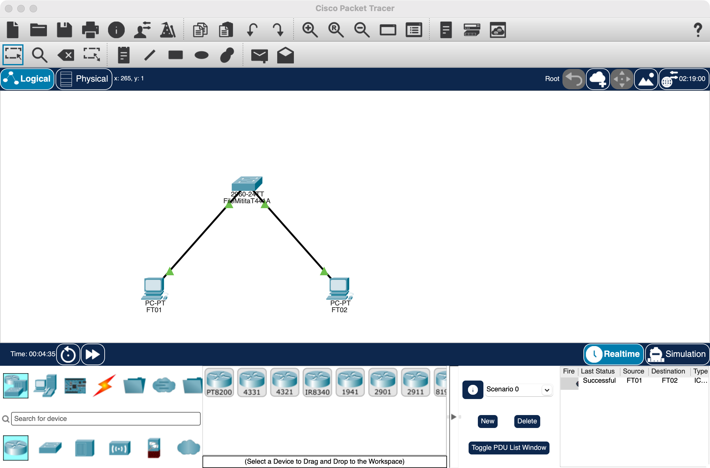
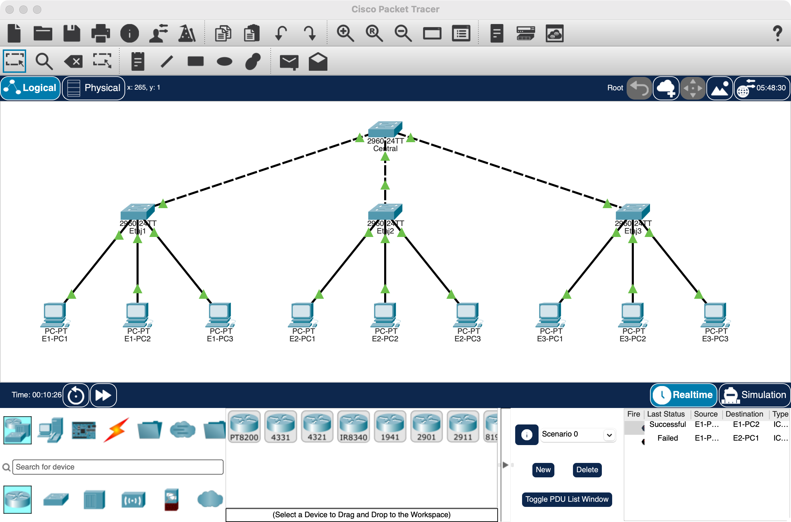
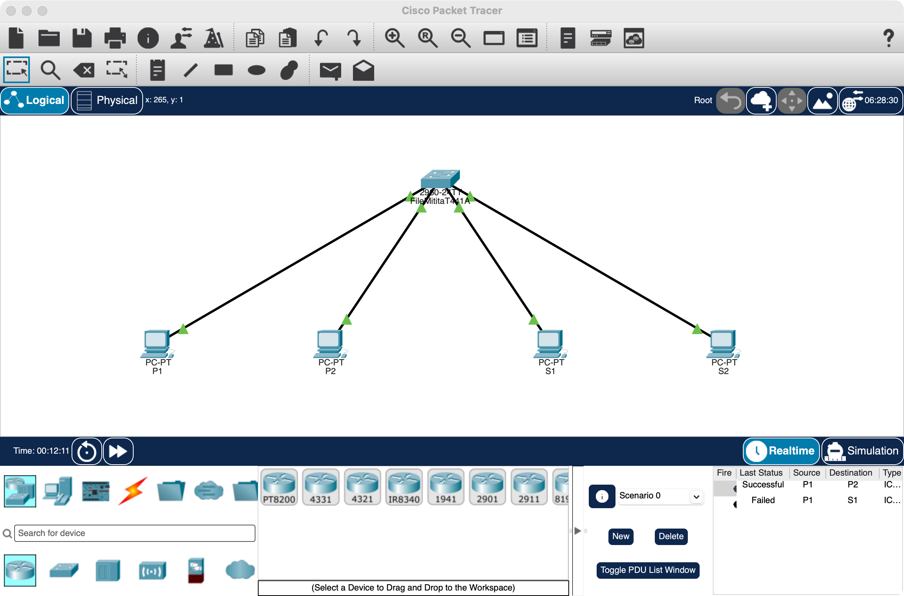

# Rețele de calculatoare – Lucrările 2 și 3

FILE-MITIŢĂ Traian, grupa 441A

## Lucrarea 2

### Exercițiul 1

192.168.100.100/28 → primii 28 de biți sunt de rețea, ultimul octet: `0110 0100`.

- Masca: **255.255.255.240** (`11111111.11111111.11111111.11110000`)
- Adresa de rețea: 100 AND 240 = 96 → **192.168.100.96**
- Adresa de broadcast: 96 + 15 = 111 → **192.168.100.111**
- Număr maxim de stații: 2⁴ − 2 = **14**
- Interval stații: **192.168.100.97 – 192.168.100.110**

Cu masca /27 (255.255.255.224): rețeaua devine 192.168.100.96 – 192.168.100.127, cu 2⁵ − 2 = 30 de adrese
utilizabile (.97 – .126), deci numărul de adrese utilizabile crește cu **16** (de la 14 la 30).

### Exercițiul 2

Pentru 4 subrețele egale în 192.168.0.0/15 mai luăm 2 biți din partea de stație → /17, masca **255.255.128.0**.
Fiecare subrețea are 2¹⁵ − 2 = **32766** adrese utilizabile.

| Subrețea | Adresă rețea | Interval stații | Broadcast |
|---|---|---|---|
| 1 | 192.168.0.0/17 | 192.168.0.1 – 192.168.127.254 | 192.168.127.255 |
| 2 | 192.168.128.0/17 | 192.168.128.1 – 192.168.255.254 | 192.168.255.255 |
| 3 | 192.169.0.0/17 | 192.169.0.1 – 192.169.127.254 | 192.169.127.255 |
| 4 | 192.169.128.0/17 | 192.169.128.1 – 192.169.255.254 | 192.169.255.255 |

### Exercițiul 3

Împărțim 192.168.0.0/15 în două subrețele inegale: una /16 și una /17 (ultimul sfert, 192.169.128.0/17, rămâne
nefolosit).

| Subrețea | Mască | Adresă rețea | Interval stații | Broadcast | Adrese utilizabile |
|---|---|---|---|---|---|
| 1 | 255.255.0.0 (/16) | 192.168.0.0 | 192.168.0.1 – 192.168.255.254 | 192.168.255.255 | 65534 |
| 2 | 255.255.128.0 (/17) | 192.169.0.0 | 192.169.0.1 – 192.169.127.254 | 192.169.127.255 | 32766 |

### Exercițiul 4

O subrețea cu 2 stații are nevoie de 4 adrese (rețea + 2 stații + broadcast) → /30. Pentru 4 astfel de subrețele
trebuie 4 × 4 = 16 adrese → rețeaua minimă este **192.168.0.0/28** (masca 255.255.255.240).
Subrețelele au masca **255.255.255.252** (/30):

| Subrețea | Adresă rețea | Stații | Broadcast |
|---|---|---|---|
| 1 | 192.168.0.0/30 | 192.168.0.1 – 192.168.0.2 | 192.168.0.3 |
| 2 | 192.168.0.4/30 | 192.168.0.5 – 192.168.0.6 | 192.168.0.7 |
| 3 | 192.168.0.8/30 | 192.168.0.9 – 192.168.0.10 | 192.168.0.11 |
| 4 | 192.168.0.12/30 | 192.168.0.13 – 192.168.0.14 | 192.168.0.15 |

### Exercițiul 5

Switch-ul se numește **FileMititaT441A**, stațiile **FT01**, **FT02**. Rețeaua 192.168.0.0/30 (masca
255.255.255.252) are doar 4 adrese: rețeaua .0, broadcast .3 și două adrese de stație, deci în această configurație
pot exista **doar 2 stații**: FT01 = 192.168.0.1 și FT02 = 192.168.0.2. Ping de la FT01 la FT02:



### Exercițiul 6

Cu switch-uri de 4 porturi, fiecare legătură switch–switch ocupă câte un port la ambele capete. Cu k switch-uri
legate în stea rămân 4k − 2(k − 1) = 2k + 2 porturi libere pentru stații; pentru 9 stații trebuie 2k + 2 ≥ 9, deci
**minim 4 switch-uri**. Switch-ul central FileMititaT441A01 e legat la FileMititaT441A02, 03 și 04, iar fiecare
dintre acestea are câte 3 stații (FT01 – FT09, adresele 192.168.0.1 – 192.168.0.9, masca 255.255.255.0).

**Numărul maxim** de switch-uri are sens să fie **9**, câte o stație pe fiecare switch (un switch în plus nu ar
avea nicio stație). Ca adresare, rețeaua 192.168.0.0/24 permite 254 de stații; cu cele 4 switch-uri se pot conecta
fizic maxim 10 stații (al patrulea port al switch-ului central e liber). Ping de la FT01 la FT09:


## Lucrarea 3

### Exercițiul 1

La fiecare etaj sunt maxim 15 stații, deci 45 în total. Cu 3 switch-uri de 16 porturi nu se poate: sunt 48 de
porturi, dar 2 legături între switch-uri ocupă 4, rămân 44 < 45. Folosim **4 switch-uri**: câte unul pe fiecare
etaj (15 stații + 1 port pentru legătură) și un switch central la etajul 2, la mijloc, ca firele verticale să fie
cât mai scurte (câte un etaj).

Toate stațiile sunt în rețeaua 192.168.0.0/16 (masca 255.255.0.0): etajul 1 – 192.168.1.1 – .3, etajul 2 –
192.168.2.1 – .3, etajul 3 – 192.168.3.1 – .3. Ping de la o stație de la etajul 1 la etajele 2 și 3 merge:


### Exercițiul 2

Păstrăm switch-urile și cablurile, schimbăm doar adresele. Un etaj are nevoie de 15 adrese de stație: /28 dă doar
14, așa că folosim /27 (30 de stații), masca **255.255.255.224**, subrețele consecutive de la începutul rețelei:

| Etaj | Subrețea | Stații | Broadcast | Stații folosite |
|---|---|---|---|---|
| 1 | 192.168.0.0/27 | 192.168.0.1 – 192.168.0.30 | 192.168.0.31 | .1 – .3 |
| 2 | 192.168.0.32/27 | 192.168.0.33 – 192.168.0.62 | 192.168.0.63 | .33 – .35 |
| 3 | 192.168.0.64/27 | 192.168.0.65 – 192.168.0.94 | 192.168.0.95 | .65 – .67 |

Stațiile de la același etaj comunică. Spre alt etaj adresa e în altă subrețea și nu există router (default
gateway), deci ping-ul dă „Request timed out”:



### Exercițiul 3

Rețeaua 192.168.10.0/24 cu 4 stații (masca 255.255.255.0): purchase – 192.168.10.1 și .2 pe porturile Fa0/1,
Fa0/2; sales – 192.168.10.3 și .4 pe Fa0/3, Fa0/4. Configurarea VLAN-urilor pe switch:

```
enable
configure terminal
vlan 2
 name purchase
vlan 3
 name sales
interface range fa0/1 - 2
 switchport mode access
 switchport access vlan 2
interface range fa0/3 - 4
 switchport mode access
 switchport access vlan 3
end
show vlan brief
```

Ping în același VLAN (192.168.10.1 → .2) merge, iar între VLAN-uri (192.168.10.1 → .3) dă timeout:


