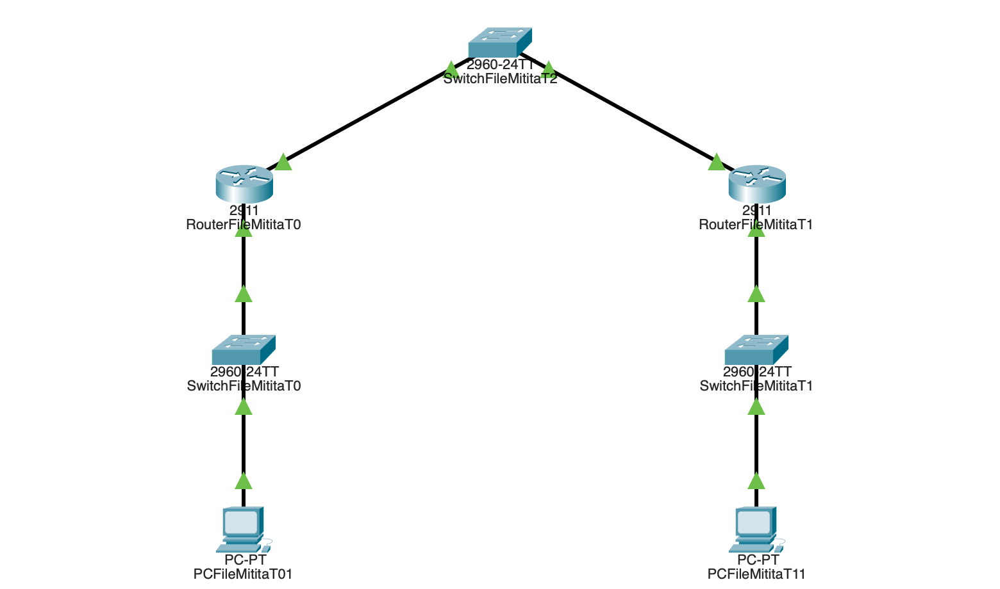
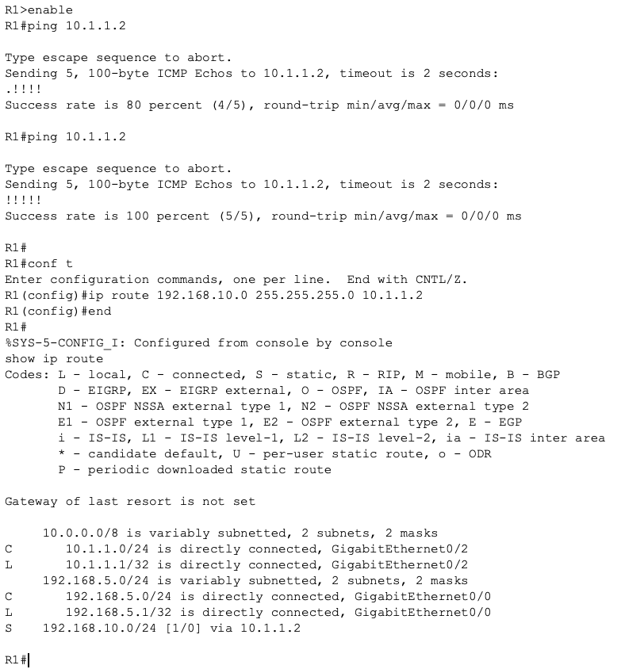
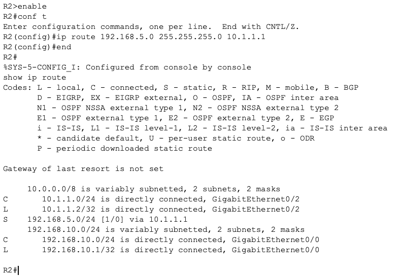
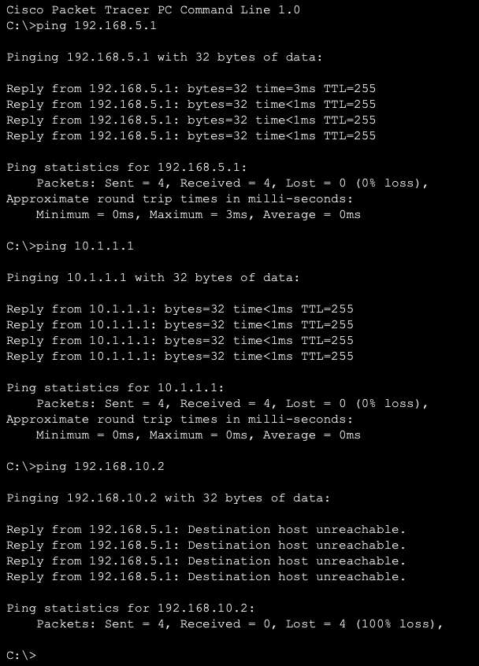
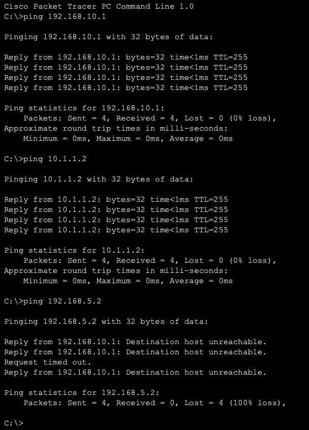
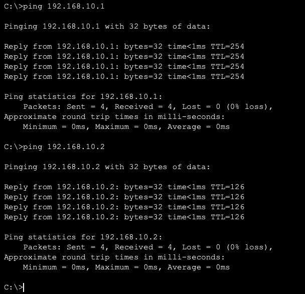
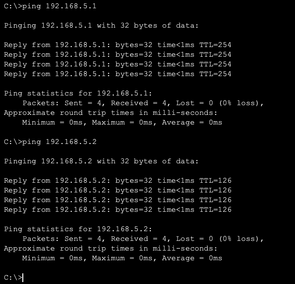
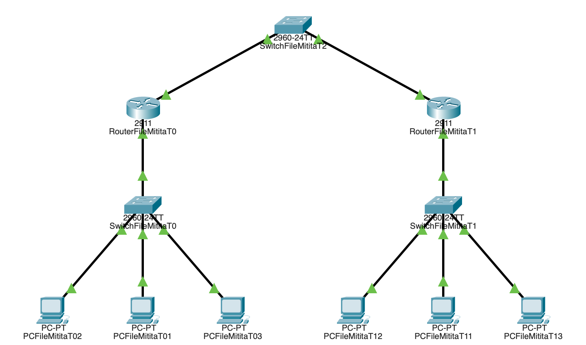
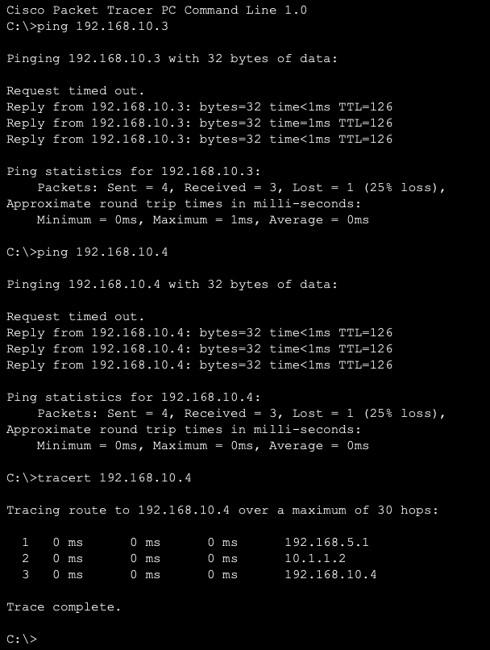
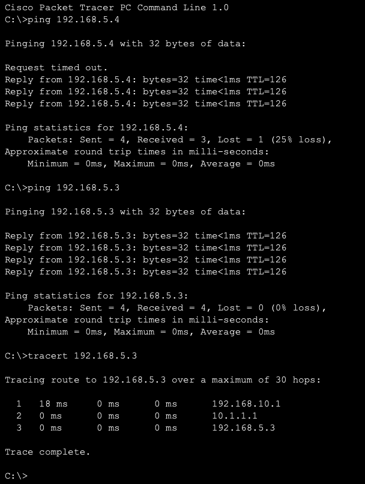

# Rețele de calculatoare – Lucrarea 4

FILE-MITIŢĂ Traian, grupa 441A

## Exercițiul 1

Am făcut rețeaua din lucrare în Packet Tracer: 2 rutere 2911, 3 switch-uri 2960 și câte un PC în fiecare rețea.
PC-urile sunt legate la switch pe FastEthernet, iar switch-urile la rutere pe GigabitEthernet. Toate măștile sunt
255.255.255.0. Switch-urile se numesc SwitchFileMititaT0 (rețeaua #1), SwitchFileMititaT1 (rețeaua #2) și
SwitchFileMititaT2 (rețeaua ruterelor, 10.1.1.0).

| Echipament | Nume în Packet Tracer | Adrese |
|---|---|---|
| Ruterul rețelei #1 (R1) | RouterFileMititaT0 | Gi0/0 192.168.5.1, Gi0/2 10.1.1.1 |
| Ruterul rețelei #2 (R2) | RouterFileMititaT1 | Gi0/0 192.168.10.1, Gi0/2 10.1.1.2 |
| PC0 (rețeaua #1) | PCFileMititaT01 | 192.168.5.2, gateway 192.168.5.1 |
| PC1 (rețeaua #2) | PCFileMititaT11 | 192.168.10.2, gateway 192.168.10.1 |

Pe rutere am dat comenzile din lucrare (hostname, adresele pe Gi0/0 și Gi0/2, `no shutdown`).



Am adăugat rutele statice din consola fiecărui ruter:

```
R1(config)# ip route 192.168.10.0 255.255.255.0 10.1.1.2
R2(config)# ip route 192.168.5.0 255.255.255.0 10.1.1.1
```

Ping-ul între rutere (R1 → 10.1.1.2) merge. Primul pachet se pierde din cauza ARP. În `show ip route` apare ruta
statică (S) lângă rețelele direct conectate (C):

<div class="doua rute"></div>

**Înainte de rute** (primele două capturi: PC0, PC1), fiecare PC ajunge la ambele adrese ale ruterului său, dar nu
și la PC-ul din cealaltă rețea. Ruterul nu are rută spre ea, așa că răspunde *Destination host unreachable*.
**După rute** (ultimele două: PC0, PC1), fiecare PC ajunge la ruterul și la stația din cealaltă rețea. TTL-ul
scade (254 la ruter, 126 la stație), deci pachetele trec prin rutere.

<div class="patru"></div>

## Exercițiul 2

Am adăugat câte 2 stații în fiecare rețea, pe porturile Fa0/2 și Fa0/3 ale switch-ului:
PCFileMititaT02 = 192.168.5.3, PCFileMititaT03 = 192.168.5.4 (gateway 192.168.5.1),
PCFileMititaT12 = 192.168.10.3, PCFileMititaT13 = 192.168.10.4 (gateway 192.168.10.1).
Pe rutere nu trebuie schimbat nimic, pentru că rutele sunt spre toată rețeaua, nu spre o stație anume.



Ping și `tracert` de la PCFileMititaT02 spre rețeaua #2 (stânga) și de la PCFileMititaT13 spre rețeaua #1
(dreapta). La fiecare ping nou se pierde primul pachet, din cauza ARP. `tracert` arată 3 noduri: ruterul propriu
(gateway-ul), celălalt ruter (adresa lui din 10.1.1.0) și stația destinație.

<div class="doua ex2"></div>
