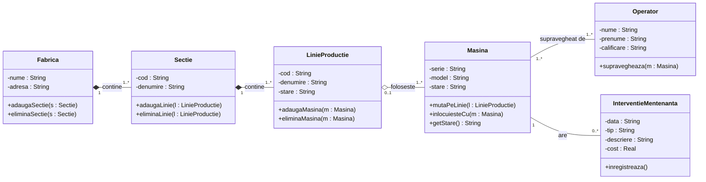

# Tema 20 – Sistem pentru administrarea unei fabrici

## Logica relațiilor

- **Fabrica – Secție: compunere (1 – 1..\*).** Secțiile fac parte din fabrică și nu există fără ea.
- **Secție – LinieProducție: compunere (1 – 1..\*).** Fiecare linie aparține unei singure secții; dacă secția dispare, dispar și liniile ei.
- **LinieProducție – Mașină: agregare (0..1 – 1..\*).** O linie folosește mai multe mașini, dar mașina există și fără linie: poate fi mutată pe altă linie (`mutaPeLinie`) sau înlocuită (`inlocuiesteCu`). 0..1 pentru că o mașină poate fi temporar nealocată.
- **Operator – Mașină: asociere (1..\* – 1..\*).** Un operator supraveghează mai multe mașini, iar o mașină are cel puțin un operator.
- **Mașină – IntervențieMentenanță: asociere (1 – 0..\*).** O intervenție se face pe o singură mașină, iar o mașină poate avea mai multe intervenții (istoricul mentenanței periodice).

Atributele sunt private (-), iar metodele publice (+).
