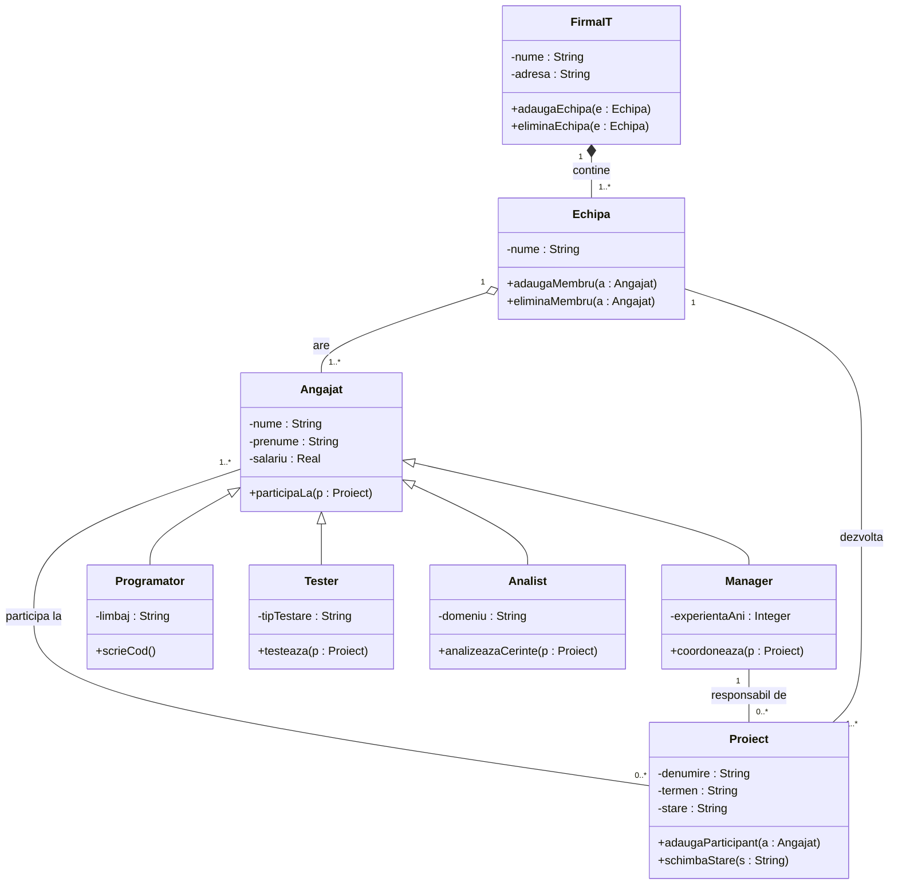

# Tema 18 – Sistem de organizare a unei firme IT

## Logica relațiilor

- **FirmaIT – Echipă: compunere (1 – 1..\*).** Echipele fac parte din firmă și nu există fără ea.
- **Echipă – Angajat: agregare (1 – 1..\*).** O echipă are mai mulți angajați, dar angajatul există și separat și poate fi mutat în altă echipă.
- **Echipă – Proiect: asociere (1 – 1..\*).** O echipă dezvoltă unul sau mai multe proiecte, iar fiecare proiect este dezvoltat de o echipă.
- **Angajat – Proiect: asociere (1..\* – 0..\*).** Un angajat poate participa la mai multe proiecte, iar un proiect are mai mulți angajați.
- **Manager – Proiect: asociere (1 – 0..\*).** Fiecare proiect are un singur manager responsabil, iar un manager poate răspunde de mai multe proiecte.
- **Generalizare: Programator, Tester, Analist, Manager → Angajat.** Toate rolurile au în comun nume, prenume, salariu și participarea la proiecte, deci le moștenesc din Angajat; fiecare rol are în plus atributele și metodele lui specifice.

Atributele sunt private (-), iar metodele publice (+).
